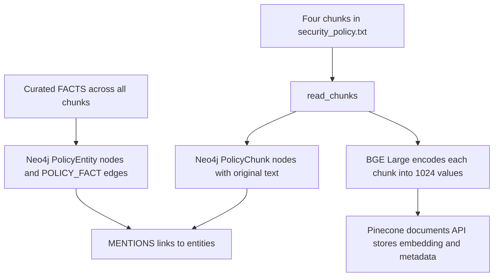
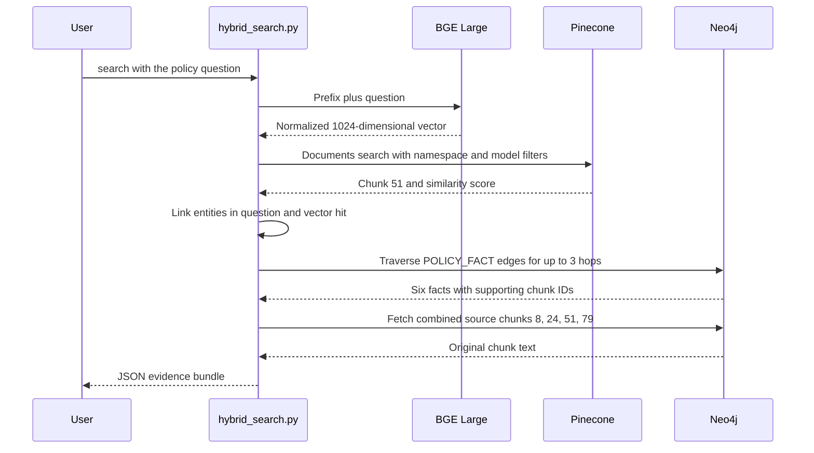

# Pinecone and Neo4j hybrid search walkthrough

This guide explains every project file and follows the sample policy from
ingestion to retrieval. The implementation uses 1024-dimensional BGE embeddings,
Pinecone's documents API, and Neo4j graph traversal. The script returns source
evidence as JSON; it does not call an LLM to generate an answer.

## 1. Files and responsibilities

```text
pinecone_neo4j_hybrid_search/
├── hybrid_search.py
├── requirements.txt
├── .env.example
├── .env                         # local only, ignored by Git
├── .gitignore
├── README.md
├── END_TO_END_FLOW.md
├── data/
│   └── security_policy.txt
└── tests/
    └── test_hybrid_search.py
```

| File | Responsibility |
| --- | --- |
| `hybrid_search.py` | CLI, configuration, chunk parsing, model loading, ingestion, vector search, graph traversal, and evidence assembly. |
| `requirements.txt` | Pinecone 10.x, Neo4j 5.x driver, Sentence Transformers, and python-dotenv dependencies. |
| `.env.example` | Shareable configuration template with placeholder values. |
| `.env` | Actual local service configuration and optional model cache path. Its contents are not included in this guide. |
| `.gitignore` | Excludes `.env`, local virtual environments, Python bytecode, and the default model cache. |
| `README.md` | Setup, commands, schema overview, and validation notes. |
| `END_TO_END_FLOW.md` | This file-by-file walkthrough and worked example. |
| `data/security_policy.txt` | One fictional policy with four explicit chunk boundaries. |
| `tests/test_hybrid_search.py` | Five offline tests using service doubles; no credentials or downloads required. |

The embedding model and virtual environment are runtime dependencies, not
committed application files. The default model cache is `.model_cache/`;
`EMBEDDING_CACHE_DIR` can point to a shorter Windows path.

### Functions in hybrid_search.py

| Function or constant | What it does |
| --- | --- |
| `DOC_ID`, `NAMESPACE` | Both identify `security-policy-001`; constrain this example to one document. |
| `FACTS` | Six manually curated relationships with source chunk IDs. |
| `ALIASES` | Controlled names for seven canonical entities. |
| `MODEL`, `EMBEDDING_DIMENSION` | Select `BAAI/bge-large-en-v1.5` and require 1024 dimensions. |
| `QUERY_PREFIX` | Adds the retrieval instruction to questions, but not document chunks. |
| `TRAVERSE` | Cypher query for one to three graph hops within the document. |
| `read_chunks()` | Validates the document ID, splits at `CHUNK` markers, and checks the four IDs. |
| `link_entities()` | Matches aliases with word boundaries, ignoring case; returns canonical entities. |
| `settings()` | Loads `.env`, checks required values, and returns connection settings. Existing process environment values take precedence over `.env`. |
| `connect()` | Opens Pinecone by host, checks its dimension, then verifies Neo4j connectivity. |
| `query()` | Runs parameterized Cypher through the Neo4j driver and returns dictionaries. |
| `ingest()` | Writes source chunks and curated facts to Neo4j, then embeddings to Pinecone. |
| `search()` | Retrieves vectors, links seed entities, traverses Neo4j, and assembles source context. |
| `main()` | Selects `ingest`, `check`, or `search`, and closes the Neo4j driver. |

## 2. The document and the question

The default question is:

> Can an external contractor download customer data to a personal laptop, and who can approve an exception?

The complete source document contains these four chunks. Their IDs preserve the
original example; there are no other chunks in the sample file.

| Chunk | Exact policy text |
| --- | --- |
| 8 | External contractors are classified as third-party users. |
| 24 | Customer data is classified as restricted data. |
| 51 | All users, including third-party users, may download restricted data only to company-managed devices. This requirement is the device restriction. |
| 79 | An exception to the device restriction requires approval from the Security Director before the download occurs. |

The example needs definitions, applicability, a restriction, and an exception.
These facts are distributed across the four chunks.

## 3. The two ingestion paths



### Neo4j ingestion

`ingest()` creates uniqueness constraints for entity names and chunk IDs,
each combined with `document_id`. It uses `MERGE` to write four `PolicyChunk`
nodes, seven `PolicyEntity` nodes, and six `POLICY_FACT` relationships.
`MENTIONS` links associate source chunks with the endpoints of their curated facts.

| Source entity | Predicate | Target entity | Source chunk |
| --- | --- | --- | --- |
| external contractor | classified_as | third-party user | 8 |
| customer data | classified_as | restricted data | 24 |
| third-party user | subject_to | device restriction | 51 |
| restricted data | download_governed_by | device restriction | 51 |
| device restriction | requires_device | company-managed device | 51 |
| device restriction | exception_requires_approval_from | Security Director | 79 |

All entity and chunk nodes carry `document_id`. Every `POLICY_FACT` edge
carries `document_id`, `predicate`, and `chunk_id`. The relationship type is
always `POLICY_FACT`; the specific meaning is stored in `predicate`.

The code does not automatically extract these facts. The developer curated
`FACTS` and `ALIASES` from the source. Entity co-occurrence alone is not used
as proof of a policy relationship.

### Pinecone ingestion

The existing Pinecone document index has this schema:

```json
{
  "fields": {
    "embedding": {
      "type": "dense_vector",
      "dimension": 1024,
      "metric": "cosine"
    }
  }
}
```

For each chunk, the model produces a normalized vector of 1024 floating-point
values. A document written by `index.documents.upsert()` has these fields:

| Field | Example for chunk 51 |
| --- | --- |
| `_id` | `"51"` |
| `embedding` | The chunk's 1024-value vector |
| `document_id` | `"security-policy-001"` |
| `chunk_id` | `51` |
| `text` | The full text of chunk 51 |
| `embedding_model` | `"BAAI/bge-large-en-v1.5"` |

The namespace is `security-policy-001`. The named vector field is `embedding`.
Metadata fields are stored alongside it. This index requires the documents API;
the legacy vectors upsert endpoint is not compatible with its document schema.

After the write, the script polls document fetch visibility every two seconds
for up to 60 seconds. Search visibility may lag behind fetch visibility.

## 4. Search from question to evidence



### Step A — Encode the question

The script prepends:

```text
Represent this sentence for searching relevant passages:
```

It then embeds the prefixed question using the same BGE model as ingestion,
with normalized output. There is a trailing space between the prefix and the
question. Document chunks do not receive this instruction.

### Step B — Search Pinecone

`search()` calls `index.documents.search()` with:

- Namespace `security-policy-001`.
- `top_k=1` by default; the CLI permits values 1 through 4.
- A `dense_vector` scoring clause targeting `embedding`.
- Metadata filters for the document ID and embedding model.
- Returned fields `chunk_id` and `text`.

In the verified live run, Pinecone retrieved chunk **51** with similarity
**0.6683397**. This is a similarity score, not a probability or confidence level.
Scores and ranking may vary across runs or model/runtime changes.

### Step C — Link seed entities

The default question links to `external contractor` and `customer data`.
Chunk 51 adds `third-party user`, `restricted data`, `company-managed device`,
and `device restriction`. These six canonical entities become traversal seeds.

The graph was already built from all four chunks, so traversal can reach
evidence that was absent from the vector result.

### Step D — Traverse Neo4j

The implementation uses this query:

```cypher
MATCH (seed:PolicyEntity {document_id: $doc})
WHERE seed.name IN $seeds
MATCH p=(seed)-[:POLICY_FACT*1..3]-(other:PolicyEntity)
WHERE all(n IN nodes(p) WHERE n.document_id = $doc)
  AND all(r IN relationships(p) WHERE r.document_id = $doc)
UNWIND relationships(p) AS r
WITH DISTINCT r
RETURN startNode(r).name AS source, r.predicate AS relation,
       endNode(r).name AS target, r.chunk_id AS chunk_id
ORDER BY chunk_id, source, relation, target
```

The path can follow incoming or outgoing edges to discover evidence. Returned
facts preserve their stored direction. Traversing an edge backward does not
create an inverse policy rule. The query deduplicates relationships found
through multiple paths and checks document scope at every node and edge.

A single seed can reach the approver in three hops:

```text
customer data
  --classified_as [24]--> restricted data
  --download_governed_by [51]--> device restriction
  --exception_requires_approval_from [79]--> Security Director
```

The default search has multiple seeds and returns all six facts. The `check`
command separately verifies this path starting only from `customer data`.

### Step E — Assemble source context

```text
Vector chunk IDs      = {51}
Graph chunk IDs       = {8, 24, 51, 79}
Graph-added chunk IDs = {8, 24, 79}
Combined context     = {8, 24, 51, 79}
```

The script fetches the original text for the combined IDs from Neo4j, sorted
by chunk ID. It reports an error if any expected source chunk is missing.

## 5. Returned JSON and supported answer

The JSON fields are:

| Field | Meaning in the verified example |
| --- | --- |
| `document_id` | `security-policy-001` |
| `question` | The question supplied by the user or the default question |
| `vector_hits` | Chunk 51 and its Pinecone score |
| `seed_entities` | Six entities linked from the question and vector result |
| `graph_facts` | Six directed facts with source chunk IDs |
| `graph_added_chunk_ids` | `[8, 24, 79]` |
| `context` | Original text of chunks 8, 24, 51, and 79 |

A human or a downstream answer model can use that evidence to say:

> An external contractor is a third-party user [8]. Customer data is restricted
> data [24], and the device restriction applies to third-party users [51]. A
> download therefore requires a company-managed device [51], unless the Security
> Director approves an exception before the download [79]. Personal ownership
> alone does not establish whether a laptop is company-managed.

This paragraph illustrates an answer supported by the evidence. The current
script itself prints the JSON bundle, not this generated prose.

## 6. Run the complete example

Run these commands from the project folder in PowerShell. They use the shorter
virtual environment created for this checkout to avoid Windows path limits:

```powershell
$hybridPython = "$env:USERPROFILE\Documents\Codex\.venvs\hybrid1024\Scripts\python.exe"
& $hybridPython hybrid_search.py ingest
& $hybridPython hybrid_search.py check
& $hybridPython hybrid_search.py search
& $hybridPython hybrid_search.py search --question "Who approves device restriction exceptions?"
& $hybridPython hybrid_search.py search --top-k 2
```

For a fresh setup, create a virtual environment, install `requirements.txt`,
and copy `.env.example` to `.env` only if `.env` does not already exist.
Fill in the Pinecone and Neo4j configuration before running the commands.
See `README.md` for the complete setup procedure.

| Environment variable | Purpose |
| --- | --- |
| `PINECONE_API_KEY` | Authenticates Pinecone requests. |
| `PINECONE_INDEX_HOST` | Identifies the existing document index host. |
| `NEO4J_URI` | Neo4j connection URI; the local instance uses port 7687. |
| `NEO4J_USERNAME` | Neo4j login name. |
| `NEO4J_PASSWORD` | Neo4j login password. |
| `NEO4J_DATABASE` | Target database, defaulting to `neo4j`. |
| `EMBEDDING_CACHE_DIR` | Optional model cache location; a short path helps on Windows. |

Neo4j must be running before ingestion, checking, or searching. `check` does
not load the embedding model; it checks graph evidence and four Pinecone IDs.

## 7. Validation and troubleshooting

Run the offline suite:

```powershell
python -m unittest discover -s tests -v
```

The five tests verify:

1. Four expected chunks and valid source chunk IDs on all six curated facts.
2. Entity aliases and word boundaries, including avoiding `subcontractor` as a match for `contractor`.
3. Evidence merging, the 1024-value query, vector field, document filter, and model filter.
4. A useful error when Pinecone returns no matches.
5. An error when Neo4j is missing a required source chunk.

The offline suite uses test doubles; it does not execute Cypher or live SDK
requests. Separately, live ingestion, the three-hop `check`, and the default
search completed successfully with the configured services.

| Symptom | Action |
| --- | --- |
| Missing configuration value | Set the named variable in `.env` or the process environment. |
| Dimension mismatch | Use the 1024-dimensional `embedding` field and the same BGE model for chunks and questions. |
| Document schema rejects a vector write | Install Pinecone 10.x and use `index.documents`, as this project does. |
| No search matches | Run ingestion, wait for Pinecone visibility, then check namespace and model filters. |
| Neo4j connection refused | Start the configured instance and confirm the Bolt port and URI. |
| Neo4j authentication failure | Check the configured credentials without changing the database password automatically. |
| Windows path error during dependency or model installation | Use a shorter virtual environment and `EMBEDDING_CACHE_DIR`. |
| Missing source chunks | Rerun ingestion before searching. |

## 8. Extending the example

For a new document, replace the fixed chunk parser, curated `FACTS`, and alias
table with an ingestion process that extracts and reviews entities and relations
from every chunk. Preserve document, version, and source chunk IDs.

Use a new document/version ID and namespace for revisions. Repeated ingestion
is idempotent for this fixed sample, but edited source material can leave old
facts because the code does not delete obsolete relationships. Writes across
Pinecone and Neo4j are not atomic; rerun ingestion after a partial failure.

For larger graphs, rank and limit expanded evidence before constructing an
answer prompt. The current code bounds traversal depth but does not rank graph
facts or implement a general policy reasoning engine.
